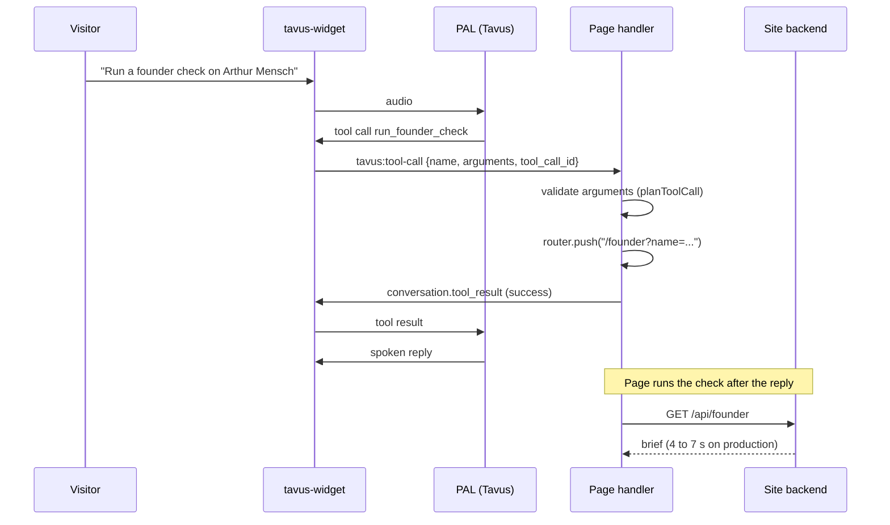

# Tavus PAL integration: findings report

**Site:** DiligenceHub, diligence.bivek.ai
**PAL:** Diligence Doctor (floating video guide)
**Author:** Bivek Adhikari
**Date:** 2026-11-09

## 1. Summary

I integrated a Tavus PAL as a floating video guide on every page of DiligenceHub, a Next.js due-diligence site for venture investors. The guide follows the visitor across pages, receives page context, and acts on the site through three app-message tools. The top issue is a freeze during a five-minute test call. I ruled out my own tool handlers as the cause: the page replies to every tool call in under 100 ms, before any backend work finishes. My top two asks are (1) help isolating the freeze on the PAL side, and (2) a configurable way for the PAL to fill processing time so the visitor does not watch a frozen avatar.

## 2. Environment

| Item | Value | Evidence |
|---|---|---|
| Framework | Next.js 14.1.0, pages router | `node_modules/next/package.json`; no `src/app/`, root is `src/pages/_app.js` |
| Widget | `@tavus/widget` 0.26.1, dependency pinned to `latest` | `package.json` line 24; `package-lock.json` resolves `widget-0.26.1.tgz` |
| Deployment | `<DEPLOYMENT_ID>` | `src/config/tavus.js` |
| Browser tested | Chromium 152 (embedded browser on macOS) | `navigator.userAgent` |
| Hosting | Vercel, production domain diligence.bivek.ai | |
| Date of tests | 2026-11-09 | |

## 3. Architecture

One `<tavus-widget>` is mounted once in the app root, so the element and its call survive client-side navigation. It loads client-only. When a call starts, `conversational-context` describes the site and the visitor's current section and query. During a call, every route or query change sends `conversation.append_llm_context`. Three PAL tools reach the page as `tavus:tool-call`. The handler validates the arguments, navigates with the Next.js router, and replies with `conversation.tool_result` on the same `tool_call_id`. The destination page then runs any backend work on its own.



## 4. Findings

### Finding 1. Avatar freezes during a call (Severity: High)

**What happens.** Diligence Doctor froze during a five-minute test call. *Reported by user, not reproduced.* The same query run manually on the site returned in 30 seconds or less (reported). On 2026-11-09 I measured the site's own searches on production at 4.2 s (research) and 7.0 s (founder check).

**Steps to reproduce.** Start a call on diligence.bivek.ai, ask the guide to research a company or check a founder, keep talking for several minutes. Exact prompts and timestamps: `TODO: measure` (see Appendix C).

**Expected vs actual.** Expected: the avatar keeps speaking or idles naturally while it thinks. Actual: the avatar froze.

**Evidence.**

My handler sends `tool_result` right after the route change and never waits for the backend (`src/components/tavus/TavusGuide.js` lines 53 to 56). I measured this two ways by dispatching `tavus:tool-call` events by hand.

| Call | Tool | Tool call received to result sent | Backend time | Avatar froze? |
|---|---|---|---|---|
| Production, manual dispatch | `go_to_section` | 13 ms | none | n/a (no live call) |
| Production, manual dispatch | `run_founder_check` | 10 ms | 7.0 s, after the reply | n/a |
| Production, manual dispatch | `run_research` | 18 ms | 4.2 s, after the reply | n/a |
| Local, debug timeline | `go_to_section` | 81 ms | none | n/a |
| Local, debug timeline | `run_founder_check` | 9 ms | 1.2 s, after the reply | n/a |
| Local, debug timeline | `run_research` | 92 ms | 0.8 s, after the reply | n/a |
| Live call 1 (control) | `go_to_section` | `TODO: measure` | none | `TODO` |
| Live call 2 | `run_research` | `TODO: measure` | `TODO: measure` | `TODO` |
| Live call 3 | `run_founder_check` | `TODO: measure` | `TODO: measure` | `TODO` |

Local backend times are low because the local server has no web search keys. Production numbers are the representative ones.

Knowledge base attached to the PAL: about 11,100 words across 8 documents plus the site URL (counted with `wc -w`): site overview and navigation (2,024), walkthroughs, FAQ and limits (1,533), AGENTS.md (1,801), DESIGN.md (369), NETWORK-MAP.md (1,982), USER_FLOW.md (827), README.md (2,481), docs/README.md (76). Persona prompt length: `TODO: measure`.

**Conclusion so far.** The site does not own the tool-call latency. The reply leaves the page in under 100 ms in every case I measured. Whether the freeze comes from my PAL configuration (knowledge base retrieval, persona prompt) or from the PAL runtime is unclear until the three live calls in Appendix C are run.

**Suggested fix (Tavus).** Expose per-turn timing in the portal or in `tavus:protocol-message`: speech end, LLM start, retrieval time, tool call sent, tool result received, speech start. That would let a customer see where a turn spends its time without a support ticket.

**Workaround I used.** None yet. My next step is a call with the knowledge base detached, to see if the freeze goes away.

### Finding 2. No filler while the PAL is processing (Feature request, tied to Finding 1)

**What happens.** When the PAL is thinking, the avatar goes still. There is no configurable behaviour for that gap.

**Expected vs actual.** Expected: an option to cover processing time. Actual: silence and a still avatar.

**Suggested fix.** A deployment or persona setting for processing time: a spoken "one moment" after a threshold, light engagement (a short acknowledgement of the request), or a visible thinking state in the widget. Customer service deployments would benefit most.

**Workaround I used.** My tool replies give the PAL a sentence to speak right away ("Running research for ... Results appear on the page in a few seconds.", `src/components/tavus/guideTools.js` line 83). This does not cover thinking time before a tool call.

### Finding 3. No Next.js or SSR guidance in the widget docs (Severity: Medium)

**What happens.** The widget page has install steps and a JSX usage line, but nothing about server rendering. A static import in a server-rendered page fails, because the custom element is browser-only.

**Steps to reproduce.** Add `import "@tavus/widget"` to a component rendered on the server in a Next.js pages-router app.

**Expected vs actual.** Expected: a framework snippet. Actual: I had to work out client-only loading and a single mount myself.

**Evidence and workaround.** `src/pages/_app.js` lines 5 to 9 and 15 load the component with `next/dynamic` and `ssr: false` and render it once next to the page. The package is a static import inside that component (`src/components/tavus/TavusGuide.js` lines 15 and 16). See Appendix A.

**Suggested fix.** Add a short "Next.js" section with one snippet for the pages router (`_app.js` with `next/dynamic`) and one for the app router (`"use client"` component in `app/layout.tsx`), plus the rule to mount once in a layout that survives navigation.

### Finding 4. Docs and types out of sync (Severity: Medium)

**What happens.** The host-communication docs list the `TavusIntegration` methods as `on`, `off`, `startConversation`, `createConversation`, `endConversation` and `sendMessage`. The installed types also expose `open`, `close` and `updateConfig`. Two event names are typed but never fire.

**Evidence.** `node_modules/@tavus/widget/dist/integration.d.ts`:
- lines 111, 112 and 129: `open(): void;`, `close(): void;`, `updateConfig(config: Record<string, unknown>): void;` on `TavusIntegration`.
- lines 35 to 37 and 59 to 61: `"tavus:chat-message"` and `"tavus:message"` in `TavusEventName` and `TavusEventMap`, with the comment "Retained for type-back-compat; never emitted at runtime."

**Expected vs actual.** Expected: the docs and the types list the same API. Actual: a developer reading only the docs misses three methods, and a developer reading only the types can build on two events that never fire.

**Suggested fix.** List every helper method in the docs. Mark the two legacy events `@deprecated` in the types, or remove them from `TavusEventName` so they do not autocomplete.

### Finding 5. No way to test tools before the PAL has them (Severity: Medium)

**What happens.** A tool call reaches the page only when the tool exists on the PAL and a live call is running. Until then the page handler cannot be tested end to end.

**Expected vs actual.** Expected: a way to fire a sample tool call at the page. Actual: I tested by dispatching the event by hand (Appendix D), which skips the PAL, the transport and the `tool_result` round trip.

**Evidence.** Unit tests cover the tool logic: `tests/unit/features/tavusGuide.test.js`, 6 tests passing.

**Suggested fix.** A test mode in the portal that sends a sample `tavus:tool-call` with a chosen name and arguments to a page with the deployment open, and shows the `tool_result` the page sends back.

### Finding 6. Tool spec drift between the PAL and the page (Severity: Medium)

**What happens.** Tool names and parameter schemas live in the PAL Maker. The handlers live in site code. Nothing checks that the two match. A renamed tool or parameter fails silently: the page falls through to `Unknown tool` (`src/components/tavus/guideTools.js` line 95).

**Evidence.** The handler schemas in this repo (`src/components/tavus/guideTools.js` lines 7 to 9, specs in `docs/tavus/03-pal-tools.md`):
- `go_to_section { section: "open_research" | "network_map" | "founder_check" }`
- `run_research { query: string }`
- `run_founder_check { name: string, company?: string }`

**Suggested fix.** JSON export and import of a PAL's tool definitions, so the site repo can hold the source of truth. Or a validation step that compares the tools on a PAL with the names a page reports it handles.

### Finding 7. Avatar background is fixed (Severity: Low)

**What happens.** The background is part of the replica source. There is no per-deployment scene setting, and the page cannot draw anything behind the video because the widget renders in its own shadow DOM.

**Expected vs actual.** Expected: a way to set a branded background per deployment. Actual: I designed a branded background plate (`docs/tavus/media/`) and had no place to use it.

**Suggested fix.** A background or scene setting on the deployment, or background replacement on replicas.

### Finding 8. Microphone message is ambiguous (Severity: Low)

**What happens.** In an embedded Chromium browser on macOS the popup showed "Microphone is blocked. Allow access in your browser settings to continue." I observed this on 2026-11-09.

**Expected vs actual.** The message is correct for a browser permission problem. It does not help a user or developer tell that apart from a page or iframe policy block (the widget docs mention `MICROPHONE_BLOCKED_BY_PAGE` for that case).

**Suggested fix.** Show different copy for the two causes, and link the iframe `allow="microphone; camera"` and `Permissions-Policy` guidance in the developer-facing error.

## 5. What worked

- One tag and a deployment id. No backend, no API keys in the page.
- The `tool_call_id` pairing contract is simple to implement and to test.
- `conversation.append_llm_context` kept a multi-page site in sync during a call with a few lines of code.
- Markdown docs and `llms.txt` let a coding assistant integrate correctly on the first pass.

## 6. Open questions for Tavus

1. For the freeze: what does Tavus need? I can provide conversation ids, UTC timestamps of the freeze, a HAR file, and the debug timeline from Appendix C.
2. Does knowledge base size (about 11,100 words here) add latency per turn? Is there a recommended limit?
3. Does `on_resolve: generate_response` add a full LLM turn after each tool result? Is `fire_and_forget` faster for navigation tools?
4. Is there per-turn timing data I can read in the portal today?
5. Is a scene or background setting on the roadmap?

**Measurements still to fill in:** the three live calls in Appendix C, and the persona prompt length.

## Appendix

### A. Layout mount and dynamic import (`src/pages/_app.js`)

```js
import dynamic from 'next/dynamic';

const TavusGuide = dynamic(() => import('../components/tavus/TavusGuide'), { ssr: false });

function MyApp({ Component, pageProps: { session, ...pageProps } }) {
  return (
    <SessionProvider session={session}>
      <Component {...pageProps} />
      <TavusGuide />
      <Analytics />
    </SessionProvider>
  );
}
```

### B. Tool handler (`src/components/tavus/TavusGuide.js`, lines 43 to 57, debug marks removed)

```js
const onToolCall = (e) => {
  const { name, arguments: rawArguments, tool_call_id: toolCallId } = e.detail || {};
  const plan = planToolCall(name, rawArguments);
  const reply = (status, output) => {
    if (!toolCallId) return;
    integration.sendMessage({ event_type: 'conversation.tool_result', properties: { tool_call_id: toolCallId, status, output } });
  };
  if (plan.error) { reply('error', plan.error); return; }
  router.push(plan.href, undefined, { scroll: true })
    .then(() => reply('success', plan.say))
    .catch(() => reply('error', 'The page could not be opened.'));
};
```

### C. Latency test script

The timing marks in `src/components/tavus/debug.js` are off by default. Open any page with `?tavusDebug=1` to turn them on in that browser (`?tavusDebug=0` turns them off). They log tool call received, validated, `tool_result` sent, backend start and end, conversation start and end, state changes, and speaking and utterance events.

1. Open `https://diligence.bivek.ai/?tavusDebug=1` in Chrome with DevTools open (Console and Network, "Preserve log" on).
2. **Call 1 (control):** start a call. Say "Take me to the Network Map." Wait for the reply. End the call. Note the time and conversation id.
3. **Call 2 (research):** start a call. Say "Research Stripe's latest funding round." Wait for the reply and the results. End the call.
4. **Call 3 (founder):** start a call. Say "Run a founder check on Arthur Mensch at Mistral." Wait for the reply and the brief. End the call.
5. After each call, run `copy(JSON.stringify(window.__tavusTimeline, null, 2))` in the Console and save it. Note whether and when the avatar froze.
6. Optional: repeat Call 1 with the knowledge base detached from the PAL.

### D. Manual tool-call dispatch (workaround for Finding 5)

```js
document.querySelector('tavus-widget').dispatchEvent(new CustomEvent('tavus:tool-call', {
  bubbles: true,
  composed: true,
  detail: { name: 'run_research', arguments: JSON.stringify({ query: 'Stripe funding' }), tool_call_id: 'test-1' },
}));
```
